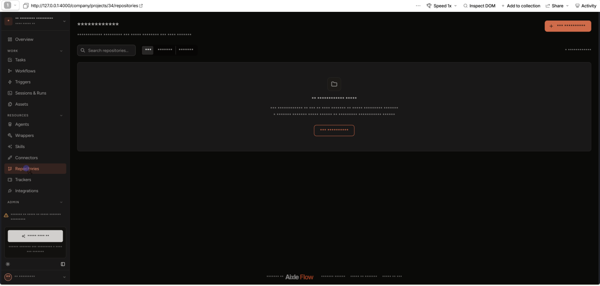

# Product analytics

How Aixle Flow reports usage to PostHog (task #224), and the rules a change to it
has to keep. PostHog is for behaviour; Sentry stays for errors.

## When anything is sent

Only from the hosted product (`Deployment.saas?`) with `POSTHOG_KEY` set, only for a
person whose `users.analytics_consent` is `granted`, and never while a super admin
impersonates someone. `Analytics.enabled?` and `Analytics.browser_config` decide; the
browser loads posthog-js only when the server shares an `analytics` prop. Development
sends nothing unless `POSTHOG_ENABLE_IN_DEV=1`. The test settings are self-hosted with
no key, so the suite sends nothing unless a test calls `enable_analytics!`.

Pages whose URL is a credential — `/login/magic/:token`, `/password/reset/:token`,
`/invitations/:token`, `/share/:token` — get `capture: false`: the consent banner is
shown, analytics is not loaded. `before_send` scrubs the same paths, and the `token`,
`code`, `state` and `email` query parameters, as a second line of defence
(`shared/lib/urlScrub.ts`). Admin pages are Administrate, with no Inertia and no
analytics.

## Consent

`null` is "never asked", not a refusal; nothing is sent for it. The banner
(`shared/ui/AnalyticsConsentBanner.tsx`) asks when the prop is present and nobody has
answered. A signed-in answer is `PATCH /analytics_consent`; an anonymous one is the
`analytics_consent` cookie, adopted onto the account at the next signed-in request
(`Web::ApplicationController#adopt_analytics_consent_cookie`). Do Not Track and Global
Privacy Control are a refusal, stored like one. Profile → Privacy changes the answer.

## Identity

`distinct_id` is the user id. No email, no name, no IP (`$geoip_disable` on server
events; "Discard client IP data" in the project). Company facts ride on every event
(`Analytics::Context`), because one person can belong to several companies and group
analytics is a paid add-on.

A stranger's signup crosses browsers: the form sends the anonymous `distinct_id` and
the consent choice, both travel in the encrypted `WorkspaceSignupTicket`, and
`#confirm` aliases the anonymous id to the new user.

Events no person caused go to `Company#analytics_owner` — `companies.created_by`, or
the oldest active admin once that person has left. Runs started by a trigger go to the
person who started them, else the trigger's author, else nowhere.

## Where events come from

| Source | Mechanism |
|---|---|
| Server, explicit | `Analytics.capture(event, user:, company:, …)` — signup, onboarding, billing, Stripe webhooks, the trial |
| Server, models | `AnalyticsTracked` / `AnalyticsResource` callbacks, charged to `Current.analytics_actor` — set by the web controllers (`via=ui`) and the Flow MCP server (`via=mcp`); a change with no actor reports nothing |
| Server, runs | `Analytics::RunReport`, from `WorkflowRun` callbacks |
| Client | `analytics.track` in `shared/lib/analytics.ts`, plus `$pageview` on Inertia's `navigate` and the router's `error` / `httpException` events |

Server events leave through `Analytics::CaptureJob` → `Analytics::Client` (PostHog's
batch API), retried a few times and then dropped: a PostHog outage never fails a
request. `posthog-ruby` is not used: its in-process queue is lost on restart and
duplicates Solid Queue.

## Session replay

Everything is masked (`maskTextSelector: '*'`) except elements inside
`data-ph-unmask` — static navigation only, never anything that renders customer
data. `data-ph-block` removes an element from recordings entirely: agent terminals
and IDE frames, session logs and artifacts, config values, the MCP token shown once,
code and diff viewers. Autocapture keeps no text and no attributes; a button is
named with `phName()` (`data-ph-capture-attribute-ph_name`). The recorder is bundled
(`posthog-js/dist/module.full.no-external`), so no PostHog script host is contacted.
`advanced_disable_flags` turns off `/flags` and the remote config read from
PostHog's asset host: what the client records is decided in `shared/lib/analytics.ts`
alone, and a change to the PostHog project's settings cannot widen it.

A recording of the project pages, as PostHog plays it back: navigation labels only,
every name and text masked.

## Event catalog

Every event carries `company_id`, `billing_status`, `managed`, `user_role`,
`onboarding_state`, `app_version`, `via`, and `project_id` inside a project; client
events add `page_component` and `feature_area` (the spec's areas, plus
`projects` for the project list and a project's overview). A `$pageview` also carries `prev_page_component`: PostHog reports the time
spent on, and the scroll depth of, the page just left on that event (`$prev_pageview_duration`,
`$prev_pageview_max_scroll_percentage`), so page ranking groups by it.

| Event | Side | Properties |
|---|---|---|
| `signup_page_viewed` | client | `source` |
| `signup_email_sent` | server (anonymous id) | — |
| `workspace_created` | server | `auth_method`, `minutes_since_email` |
| `onboarding_step_completed` | server | `step`, `entry`, `position`, `language` |
| `onboarding_agent_connected` / `onboarding_agent_skipped` | server | `provider`, `entry` |
| `onboarding_completed` | server | `entry`, `duration_sec` |
| `project_created` | server | `is_first`, `from_template` |
| `template_installed` | server | `template_slug`, `is_first` |
| `workflow_created` / `workflow_edited` | server | `is_first`, `steps_count`, `created_via` / `change` |
| `workflow_run_started` / `workflow_run_finished` / `workflow_run_failed` | server | `trigger`, `status`, `duration_sec`, `is_first`, `failed_step_index`, `reason` |
| `trial_banner_viewed` | client | `allowance_remaining`, `allowance_unit`, `state` |
| `trial_allowance_exhausted` | server | `allowance_used`, `allowance_unit` |
| `billing_page_viewed` / `checkout_returned` | client | `entry` / `result` |
| `checkout_started`, `subscription_activated`, `payment_failed`, `subscription_cancel_requested`, `subscription_cancel_reverted` | server | `plan`, `days_since_signup`, `reason` |
| `invite_sent` / `invite_accepted` | server | `role` |
| `board_task_created` / `_moved` / `_archived` | server | `bulk_count` |
| `step_run_approved` / `_retried` / `_skipped` | server | — |
| `integration_connected`, `resource_created`, `skill_installed`, `connector_installed` | server | `provider` / `type` / `slug` |
| `builder_session_started`, `session_opened`, `docs_opened`, `search_used`, `filter_applied`, `empty_state_viewed` | client | `agent_runtime`, `session_state`, `doc_slug`, `filter` |
| `form_validation_failed`, `request_failed`, `permission_denied_shown` | client | `form`, `fields`, `status` |

No property holds text a person typed: ids, enums and counts only.
